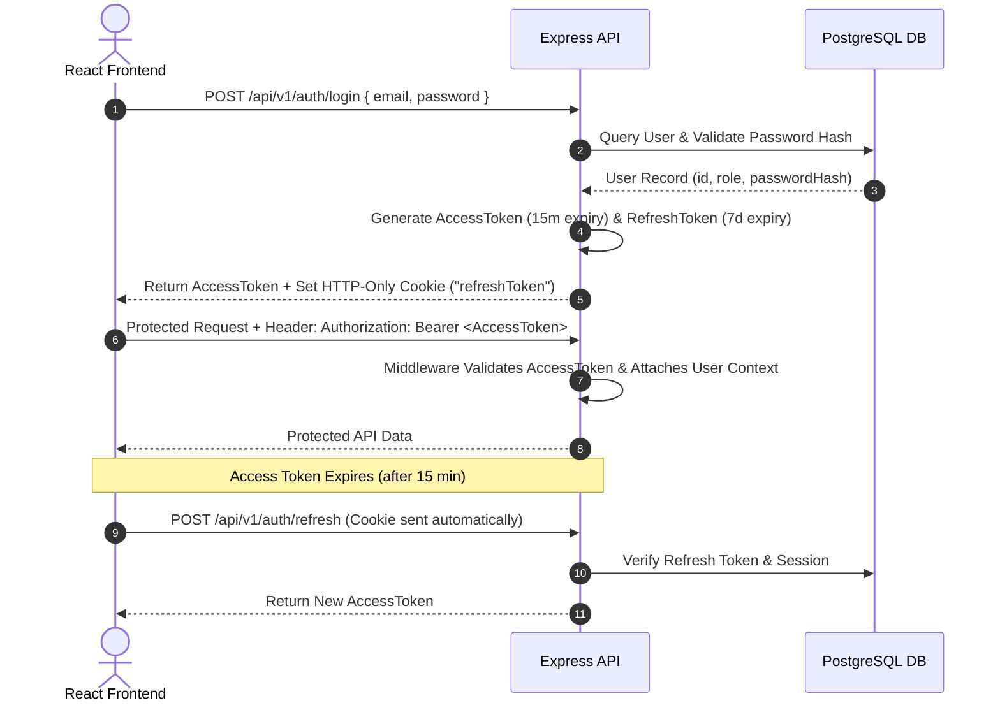

# Traveller Authentication & Role Authorization Guide

> **Authentication Model**: JWT Dual Token (Access Token + HTTP-Only Refresh Token Cookie)  
> **Password Hashing**: bcrypt (Cost factor 12)  
> **Role-Based Access Control**: Middleware guards (`requireAuth`, `requireRole`)  

---

## 1. Dual Token Lifecycle Flow

---

## 2. Role-Based Access Control Matrix

| System Endpoint Group | Minimum Required Role | Access Constraints |
| :--- | :--- | :--- |
| Public Endpoints (`/packages`, `/destinations`, `/blogs`) | None | Public read-only |
| Traveller Actions (`/trip-requests`, `/bookings`, `/reviews`) | `TRAVELLER` | Can only access owned records |
| Agency Actions (`/agency/leads`, `/agency/quotes`, `/agency/wallet`) | `AGENCY` | Can only access verified destination leads |
| Admin Control (`/admin/analytics`, `/admin/agencies/:id/kyc`) | `ADMIN` / `SUPER_ADMIN` | Full system governance |

---

## 3. Environment Variable Security Secrets
- `JWT_ACCESS_SECRET`: Secret string for signing short-lived access tokens.
- `JWT_REFRESH_SECRET`: Secret string for signing long-lived refresh tokens.
- `BCRYPT_SALT_ROUNDS`: Default set to `12`.
