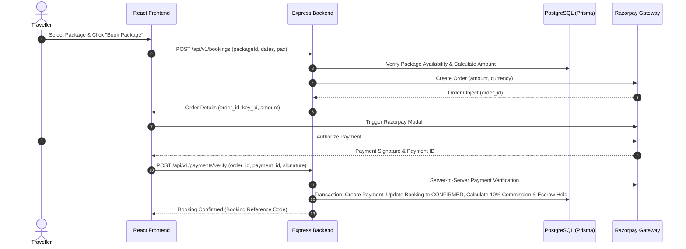
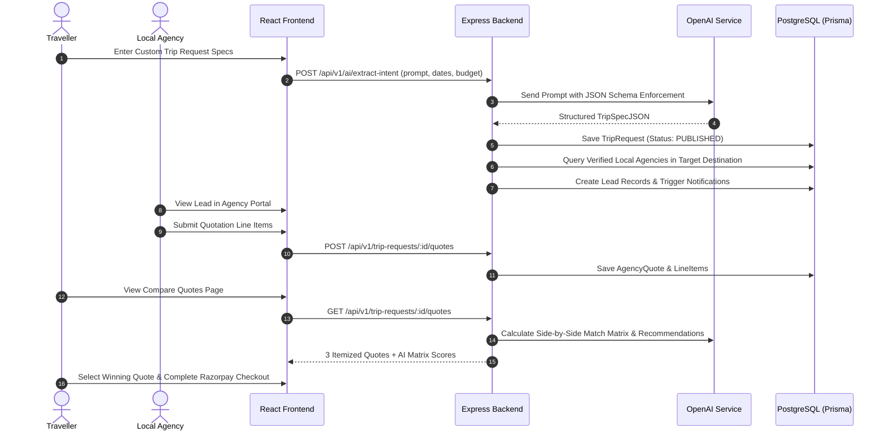

# Traveller Backend Integration & System Architecture Plan

## Executive Summary
This document defines the complete backend integration plan for **Traveller**, converting the existing Vite + React + TypeScript frontend into a production-ready, full-stack AI-powered travel marketplace without modifying the visual design, layout, styling, or existing UI/UX.

---

## 1. Existing Frontend Architecture & Route Analysis

### Application State & Routing Model
- **Framework**: Vite 8 + React 19 + TypeScript + Tailwind CSS v4.
- **Routing Engine**: Custom History-API synced hash-router (`App.tsx`), handling browser back/forward (`popstate`) and URL hash changes (`#/<route>`).
- **Data Layer**: Static mock datasets defined in `src/data/mockData.ts`.

### Mapped Page Routes & Endpoints Matrix

| Route Key | Page Component | Functional Purpose | Required Backend API Endpoints |
| :--- | :--- | :--- | :--- |
| `home` | `HomePage.tsx` | Hero search, pilot destinations, ready-made packages, testimonials, FAQs | `GET /api/v1/destinations/popular`, `GET /api/v1/packages/featured`, `GET /api/v1/faqs` |
| `about` | `AboutPage.tsx` | Company story, impact stats, mission pillars | `GET /api/v1/platform/stats` |
| `contact` | `ContactPage.tsx` | Support inquiry form, regional offices, SLA metrics | `POST /api/v1/support/inquiries` |
| `blog` | `BlogPage.tsx` | Travel guides, search & category filters, article detail modal | `GET /api/v1/blogs`, `GET /api/v1/blogs/:id` |
| `packages` | `ExplorePackagesPage.tsx` | Full package catalog, budget range filter, package detail modal | `GET /api/v1/packages`, `GET /api/v1/packages/:id` |
| `destinations` | `DestinationsPage.tsx` | Pilot destinations (Sikkim, Shimla, Manali, Ladakh) explorer | `GET /api/v1/destinations` |
| `become-agency` | `BecomeAgencyPage.tsx` | Agency onboarding landing, revenue calculator, KYC guidelines | `POST /api/v1/agencies/register-intent` |
| `ai-planner` | `AITripPlannerPage.tsx` | 4-Step AI request wizard, OpenAI intent extraction, agency broadcast | `POST /api/v1/ai/extract-intent`, `POST /api/v1/trip-requests` |
| `compare-quotes` | `CompareQuotesPage.tsx` | Side-by-side quote comparison matrix, Razorpay escrow checkout | `GET /api/v1/trip-requests/:id/quotes`, `POST /api/v1/payments/create-order`, `POST /api/v1/payments/verify` |
| `login` | `LoginPage.tsx` | Dual-role login (Traveller vs Agency), OAuth simulation, JWT issuance | `POST /api/v1/auth/login`, `POST /api/v1/auth/google` |
| `signup` | `SignupPage.tsx` | Dual-role user registration | `POST /api/v1/auth/register` |
| `traveller-dashboard` | `TravellerDashboardPage.tsx` | 11 Sub-tabs (Overview, Trips, Requests, AI, Wishlist, Bookings, Payments, Messages, Notifications, Reviews, Settings) | `GET /api/v1/traveller/dashboard`, `GET /api/v1/bookings/my-bookings`, `GET /api/v1/messages/threads` |
| `agency-dashboard` | `AgencyDashboardPage.tsx` | 8 Sub-tabs (Overview, KYC Upload, Leads Inbox, Quote Builder, Bookings, Wallet, Reviews, Settings) | `GET /api/v1/agency/leads`, `POST /api/v1/agency/quotes`, `POST /api/v1/agency/kyc`, `POST /api/v1/agency/payouts` |
| `admin-panel` | `AdminPanelPage.tsx` | 5 Sub-tabs (GMV Overview, Agency KYC Review, Users, Bookings & Escrow Release, Financial Reports) | `GET /api/v1/admin/analytics`, `PATCH /api/v1/admin/agencies/:id/kyc`, `POST /api/v1/admin/escrow/release` |

---

## 2. End-to-End Data Flow Architecture

### Flow 1: Ready-Made Package Booking

### Flow 2: AI-Powered Custom Trip & Quotation Marketplace

---

## 3. Security & Compliance Architecture

1. **Authentication**: Dual-token architecture using HTTP-Only SameSite Cookies for Access Tokens (15 min expiry) and Refresh Tokens (7 days expiry).
2. **Role-Based Access Control (RBAC)**: Middleware enforcing strict checks for `TRAVELLER`, `AGENCY`, `ADMIN`, and `SUPER_ADMIN` roles.
3. **Financial Security**: 100% server-side verification of Razorpay signatures and amount checks; optimistic concurrency lock on Wallet balances to prevent double payout disbursements.
4. **Data Isolation**: Multi-tenant context guards ensuring local agencies can only view leads for their verified operating destinations.

---

## 4. Phase-by-Phase Implementation Roadmap

- **Phase 1**: Architecture & Documentation *(Current)*
- **Phase 2**: Backend Directory Setup (`/backend`), Express + TypeScript + Prisma setup, database schema & seeder
- **Phase 3**: Authentication & Authorization (JWT, Refresh tokens, Password Hashing, RBAC Middleware)
- **Phase 4**: Core Domain APIs (Packages, Destinations, Wishlist, Reviews, Notifications)
- **Phase 5**: AI Engine & Custom Trip Request Pipeline (OpenAI Intent Extractor, Structured Specs)
- **Phase 6**: Agency Lead Inbox, Quote Builder & AI Matrix Scoring Engine
- **Phase 7**: Booking Lifecycle & Razorpay Escrow Integration
- **Phase 8**: Agency KYC Document Management & Admin Approval Workflows
- **Phase 9**: Real-time Messaging, Notifications & Review Moderation
- **Phase 10**: Admin Analytics, GMV Reports & Escrow Disbursement Operations
- **Phase 11**: Non-visual Frontend Integration (Replacing mock data calls with real API clients)
- **Phase 12**: Environment Configuration, Security Middleware, Build Verification & Deployment Docs
