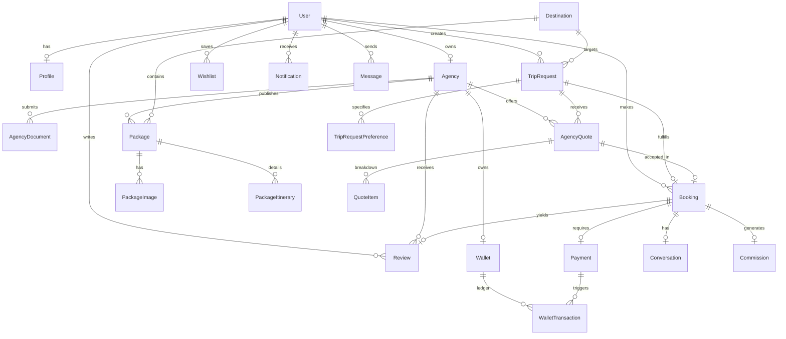

# Traveller PostgreSQL Database Architecture & Design Specification

> **Target Database**: PostgreSQL 16+  
> **ORM Engine**: Prisma ORM v6  
> **Primary Key Strategy**: UUID v4 (`@default(uuid())`)  

---

## 1. Complete Entity Relationship Blueprint

---

## 2. Table Schemas & Constraints Detail

### 1. `users`
- `id`: UUID (PK)
- `email`: VARCHAR(255) (UNIQUE, INDEX)
- `phone`: VARCHAR(20) (UNIQUE)
- `passwordHash`: VARCHAR(255)
- `role`: ENUM (`TRAVELLER`, `AGENCY`, `ADMIN`, `SUPER_ADMIN`)
- `status`: ENUM (`PENDING`, `ACTIVE`, `SUSPENDED`, `DELETED`)
- `emailVerified`: BOOLEAN (DEFAULT false)
- `createdAt`, `updatedAt`, `deletedAt`

### 2. `profiles`
- `id`: UUID (PK)
- `userId`: UUID (FK -> users.id, UNIQUE, ON DELETE CASCADE)
- `fullName`: VARCHAR(150)
- `avatarUrl`: TEXT
- `bio`: TEXT
- `emergencyContact`: VARCHAR(20)

### 3. `agencies`
- `id`: UUID (PK)
- `ownerId`: UUID (FK -> users.id, UNIQUE, ON DELETE CASCADE)
- `companyName`: VARCHAR(200)
- `slug`: VARCHAR(220) (UNIQUE, INDEX)
- `logoUrl`: TEXT
- `description`: TEXT
- `taxIdNumber`: VARCHAR(50) (GSTIN / PAN)
- `kycStatus`: ENUM (`PENDING`, `UNDER_REVIEW`, `VERIFIED`, `REJECTED`, `SUSPENDED`) (INDEX)
- `ratingAverage`: DECIMAL(3, 2) (DEFAULT 0.00, INDEX)
- `reviewCount`: INT (DEFAULT 0)
- `commissionRate`: DECIMAL(5, 2) (DEFAULT 10.00)

### 4. `agency_documents`
- `id`: UUID (PK)
- `agencyId`: UUID (FK -> agencies.id, ON DELETE CASCADE)
- `documentType`: VARCHAR(50) (TOURISM_LICENSE, GST_CERTIFICATE, BANK_PROOF, OFFICE_LEASE)
- `fileUrl`: TEXT
- `isVerified`: BOOLEAN (DEFAULT false)

### 5. `destinations`
- `id`: UUID (PK)
- `name`: VARCHAR(100)
- `slug`: VARCHAR(120) (UNIQUE, INDEX)
- `state`: VARCHAR(100)
- `country`: VARCHAR(100) (DEFAULT 'India')
- `isPopular`: BOOLEAN (DEFAULT false, INDEX)
- `isActive`: BOOLEAN (DEFAULT true, INDEX)

### 6. `packages`
- `id`: UUID (PK)
- `agencyId`: UUID (FK -> agencies.id, ON DELETE CASCADE)
- `destinationId`: UUID (FK -> destinations.id)
- `title`: VARCHAR(200)
- `slug`: VARCHAR(220) (UNIQUE, INDEX)
- `durationDays`: INT
- `durationNights`: INT
- `pricePerPerson`: DECIMAL(12, 2) (INDEX)
- `originalPrice`: DECIMAL(12, 2)
- `includedAccommodations`: TEXT
- `includedMeals`: TEXT
- `transportType`: VARCHAR(100)
- `isFeatured`: BOOLEAN (DEFAULT false, INDEX)
- `isActive`: BOOLEAN (DEFAULT true, INDEX)

### 7. `trip_requests`
- `id`: UUID (PK)
- `requestCode`: VARCHAR(20) (UNIQUE, INDEX) -- e.g. TR-2026-000001
- `travellerId`: UUID (FK -> users.id, ON DELETE CASCADE)
- `destinationId`: UUID (FK -> destinations.id)
- `status`: ENUM (`DRAFT`, `PUBLISHED`, `MATCHING`, `QUOTES_RECEIVED`, `BOOKED`, `CANCELLED`, `EXPIRED`) (INDEX)
- `startDate`: DATE
- `endDate`: DATE
- `durationDays`: INT
- `adultCount`: INT
- `childCount`: INT
- `budgetMin`: DECIMAL(12, 2)
- `budgetMax`: DECIMAL(12, 2)
- `aiStructuredSpec`: JSONB (GIN INDEX)

### 8. `agency_quotes`
- `id`: UUID (PK)
- `tripRequestId`: UUID (FK -> trip_requests.id, ON DELETE CASCADE)
- `agencyId`: UUID (FK -> agencies.id, ON DELETE CASCADE)
- `status`: ENUM (`DRAFT`, `SUBMITTED`, `ACCEPTED`, `REJECTED`, `WITHDRAWN`) (INDEX)
- `totalPrice`: DECIMAL(12, 2)
- `hotelCategory`: VARCHAR(100)
- `vehicleType`: VARCHAR(100)
- `aiMatchScore`: INT (DEFAULT 0)
- `aiRecommendationReason`: TEXT

### 9. `bookings`
- `id`: UUID (PK)
- `bookingCode`: VARCHAR(20) (UNIQUE, INDEX) -- e.g. TRV-2026-000001
- `travellerId`: UUID (FK -> users.id)
- `agencyId`: UUID (FK -> agencies.id)
- `tripRequestId`: UUID (FK -> trip_requests.id, UNIQUE, NULLABLE)
- `packageId`: UUID (FK -> packages.id, NULLABLE)
- `quoteId`: UUID (FK -> agency_quotes.id, UNIQUE, NULLABLE)
- `status`: ENUM (`PENDING_PAYMENT`, `CONFIRMED`, `IN_PROGRESS`, `COMPLETED`, `CANCELLED`, `REFUNDED`, `DISPUTED`) (INDEX)
- `grossAmount`: DECIMAL(12, 2)
- `commissionAmount`: DECIMAL(12, 2)
- `netAgencyAmount`: DECIMAL(12, 2)

### 10. `payments`
- `id`: UUID (PK)
- `bookingId`: UUID (FK -> bookings.id, UNIQUE, ON DELETE CASCADE)
- `status`: ENUM (`INITIATED`, `SUCCESS`, `FAILED`, `REFUNDED`) (INDEX)
- `razorpayOrderId`: VARCHAR(100) (UNIQUE, INDEX)
- `razorpayPaymentId`: VARCHAR(100) (UNIQUE, INDEX)
- `razorpaySignature`: TEXT
- `amount`: DECIMAL(12, 2)

---

## 3. Financial Ledger & Escrow Isolation Strategy
- All payouts to agencies are tracked in `wallets` and `wallet_transactions` tables.
- Payout funds are held in **Razorpay Escrow Mode** (`escrowHold` balance) until the traveller completes check-in.
- Optimistic locking counters (`version` field) on agency wallets prevent race conditions during payout disbursements.
